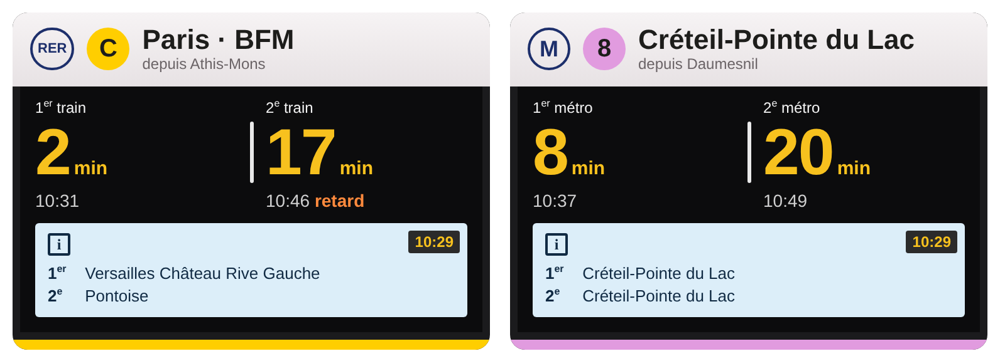
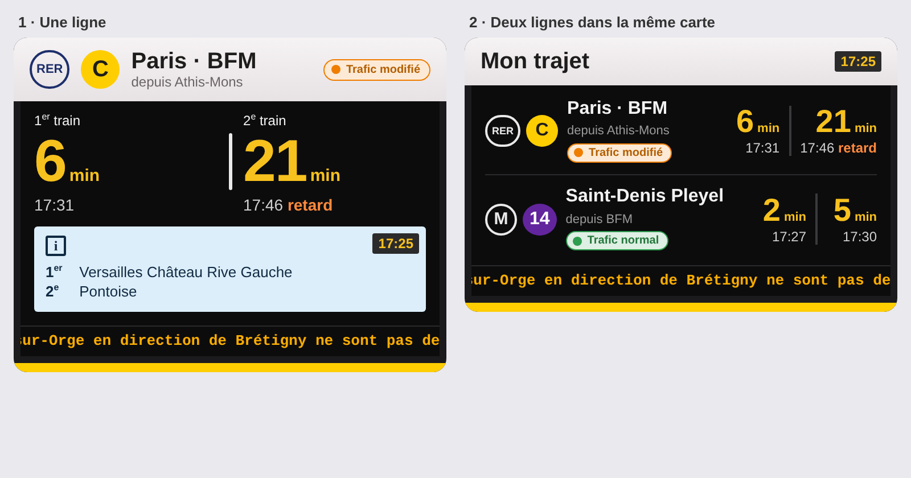

# IDFM Metrocard 🚇

Carte Home Assistant façon **panneau de quai** qui affiche les 2 prochains passages d'un arrêt d'Île-de-France (métro, RER, Transilien, tram, bus) : le temps d'attente en gros, l'heure de passage dessous, les destinations et l'**état du trafic** d'un coup d'œil. Une ou plusieurs lignes par carte.





> 🇬🇧 [English version below](#-english)

---

## ✅ Ce qu'il faut avant

La carte n'interroge pas IDFM elle-même : elle affiche les données de l'intégration **[Ile de France Mobilités](https://github.com/droso-hass/idfm)** (droso-hass/idfm).

1. **Installe l'intégration** via HACS (dépôt `droso-hass/idfm`), puis redémarre Home Assistant.
2. **Crée un compte sur [PRIM](https://prim.iledefrance-mobilites.fr)** (gratuit) et récupère ton jeton API : *Mon compte → Mes jetons*.
3. **Ajoute ton arrêt** : *Paramètres → Appareils et services → Ajouter une intégration → Ile de France Mobilités*, puis choisis le type de transport, la ligne, l'arrêt et la direction.

💡 **Conseils pour l'intégration**
- **Direction** : si la liste ne propose pas un sens qui couvre tous les terminus, choisis **`any`** et fais le tri dans la carte avec `include_destinations` / `exclude_destinations`.
- **Gare très fréquentée** (plusieurs branches, ex. RER C à Paris) : mets **12 à 16** dans *Number of time entities* pour avoir toujours 2 départs dans ton sens.

## 🔌 Sur quelles entités elle se base

Chaque arrêt ajouté dans l'intégration crée **un appareil** avec ces entités :

| Entité | Exemple | Utilisation dans la carte |
|---|---|---|
| Capteurs d'horaires `sensor.…_0` à `sensor.…_N` (*device_class* `timestamp`) | `sensor.c_athis_mons_athis_mons_any_idfm_athis_mons_athis_mons_any_0` | **État** = heure de passage. **Attributs** lus : `destination`, `direction`, `status` (`onTime`, `delayed`, `cancelled`…), `at_stop` (train à quai) |
| Info trafic `binary_sensor.…` (*device_class* `problem`) | `binary_sensor.c_athis_mons_athis_mons_any_idfm_c_athis_mons_athis_mons` | `on` = perturbation. Attributs lus : `effect` et `cause` (→ pastille d'état), `description` (→ bandeau défilant, et texte complet au toucher), `end_time` (→ « jusqu'à … ») |
| `calendar.…` | | Non utilisé |

Il suffit de choisir **l'appareil** : la carte retrouve toute seule ses capteurs, le numéro de ligne et le nom de l'arrêt.
L'intégration rafraîchit les horaires toutes les 3 minutes, et la carte recalcule le compte à rebours toutes les 15 secondes.

## 📦 Installation

### Avec HACS (recommandé)
Le plus simple : clique sur ce bouton, il ouvre directement la carte dans ta Home Assistant.

[](https://my.home-assistant.io/redirect/hacs_repository/?owner=robote7701&repository=idfm-metrocard&category=plugin)

Sinon, à la main :
1. HACS → menu **⋮** → **Dépôts personnalisés**.
2. URL : `https://github.com/robote7701/idfm-metrocard`, catégorie **Dashboard** (ou *Lovelace*).
3. Cherche **IDFM Metrocard** → **Télécharger**.
4. Recharge la page (Ctrl+Maj+R). Dans l'app : *Paramètres → Réinitialiser le cache du frontend*.

### À la main
1. Copie `idfm-metrocard.js` dans `/config/www/`.
2. *Paramètres → Tableaux de bord → ⋮ → Ressources → Ajouter* : URL `/local/idfm-metrocard.js`, type **Module JavaScript**.
3. Recharge la page.

## ⚙️ Configuration

### Avec l'éditeur visuel
*Modifier le tableau de bord → Ajouter une carte →* **IDFM Metrocard**, puis choisis ton arrêt dans la liste.

### En YAML

```yaml
type: custom:idfm-metrocard
device: 5bc9e54d59aa5d11f7249fbad5dbfc66   # ID de l'appareil IDFM
title: Paris · BFM
exclude_destinations:
  - Juvisy
  - Brétigny
  - Dourdan
  - Étampes
```

| Option | Type | Par défaut | Description |
|---|---|---|---|
| `device` | ID d'appareil | **requis*** | L'appareil IDFM de l'arrêt (sélecteur dans l'éditeur). |
| `entities` | liste | — | *Alternative à `device`* : liste explicite des capteurs d'horaires. |
| `title` | texte | direction ou nom de l'arrêt | Grand texte du bandeau (ta destination). |
| `subtitle` | texte | « depuis *arrêt* » | Petit texte sous le titre. `""` pour le masquer. |
| `include_destinations` | liste | — | Garde seulement les départs dont la destination **contient** un de ces textes (sans tenir compte des accents ni des majuscules). |
| `exclude_destinations` | liste | — | Retire les départs dont la destination contient un de ces textes. |
| `mode` | `auto` · `metro` · `rer` · `train` · `tram` · `bus` | `auto` | Type de ligne : change le picto et le libellé (« 1er métro », « 1er train »…). |
| `line` | texte | d'après l'appareil | Texte dans le rond de ligne. |
| `line_color` | `#RRVVBB` | couleur de la ligne si connue | Couleur du rond et du liseré du bas. |
| `traffic_entity` | entité | trouvée seule | Capteur d'info trafic à utiliser. |
| `show_info` | booléen | `true` | Affiche l'encart info bleu. |
| `show_traffic` | booléen | `true` | Affiche l'alerte trafic. |
| `show_clock` | booléen | `true` | Affiche l'horloge dans l'encart. |
| `show_status` | booléen | `true` | Affiche la pastille d'état du trafic dans le bandeau. |
| `show_ticker` | booléen | `true` | Affiche le bandeau défilant avec le message de perturbation. |
| `only_my_stop` | booléen | `false` | Pastille grise « Info ligne » si le message ne cite ni ton arrêt ni tes `include_destinations` (voir Limites). |
| `lines` | liste | — | Plusieurs lignes dans une même carte (voir plus bas). |

### Exemple : les deux sens d'un trajet domicile ↔ travail

Un appareil par gare (direction `any`), et le tri du sens se fait dans la carte :

```yaml
- type: custom:idfm-metrocard
  device: <appareil Athis-Mons>
  title: Paris · BFM
  exclude_destinations: [Juvisy, Brétigny, Dourdan, Étampes]

- type: custom:idfm-metrocard
  device: <appareil Bibliothèque François Mitterrand>
  title: Athis-Mons
  subtitle: depuis Bibliothèque F. Mitterrand
  include_destinations: [Juvisy, Brétigny, Dourdan, Étampes]
```

### Plusieurs lignes dans une même carte

Avec `lines`, chaque ligne devient une rangée du panneau (2 prochains départs + pastille d'état), et les messages de perturbation de toutes les lignes défilent dans le même bandeau. Chaque entrée accepte les mêmes options qu'une carte simple (`device`, `title`, `subtitle`, `include_destinations`, `exclude_destinations`, `mode`, `line_color`…).

```yaml
type: custom:idfm-metrocard
title: Mon trajet
lines:
  - device: <appareil RER C à Athis-Mons>
    title: Paris · BFM
    exclude_destinations: [Juvisy, Brétigny, Dourdan, Étampes]
  - device: <appareil métro 14 à Bibliothèque François Mitterrand>
    title: Saint-Denis Pleyel
    subtitle: depuis BFM
    include_destinations: [Pleyel]
```

ℹ️ La carte multi-lignes se règle dans l'éditeur YAML (l'éditeur visuel gère la carte à une ligne).

## 🖥️ Ce que montre la carte

- **Gros chiffre jaune** : minutes avant le départ, avec l'**heure de passage** dessous. « retard » s'affiche en orange si l'exploitant le signale.
- **À quai** / **Proche** clignote quand le train est là ou part dans la minute.
- **Pastille d'état** dans le bandeau : 🟢 Trafic normal · 🟡 Travaux · 🟠 Retards / Trafic modifié / Trafic réduit / Perturbé · 🔴 Interrompu / Grève. Appuie dessus pour lire le message complet.
- **Bandeau défilant** façon afficheur : le résumé du message de perturbation et sa fin prévue (« jusqu'à 23:50 »).
- **Encart info** : horloge, destination des 2 départs, nombre de départs supprimés.
- **Sur téléphone** (moins de 430 px de large), l'encart passe sous les chiffres.

## ⚠️ Limites

- La carte dépend des données temps réel de PRIM : sur certaines lignes ou certains arrêts, ce sont des horaires théoriques.
- Le **type de ligne** est deviné d'après son nom (A à E = RER, H/J/K/L/N/P/R/U = Transilien, T… = tram, 1 à 18 = métro, sinon bus). Force `mode` si ça se trompe (ex. un bus numéroté 8).
- **Couleurs fournies** : métro, RER et Transilien. Pour les trams et les bus, règle `line_color`.
- **Info trafic à l'échelle de la ligne** : IDFM publie ses messages pour toute la ligne, donc une perturbation loin de chez toi peut passer la pastille en orange. L'option `only_my_stop` atténue ça, mais elle se base sur les noms cités dans le message : « interrompu entre Juvisy et Austerlitz » ne cite pas les gares intermédiaires et serait mis en gris à tort. Elle est donc désactivée par défaut.
- La **Grève** est repérée par les mots « grève » ou « mouvement social » dans le message.

## 🔀 Alternatives

D'autres cartes affichent les prochains passages en Île-de-France, jette un œil pour choisir celle qui te va :

- **[lovelace-idf-mobilite](https://github.com/yyrkoon94/lovelace-idf-mobilite)** (yyrkoon94) : la liste complète des départs façon panneau de station, mode écran TV, filtres par ligne, éditeur visuel. Elle utilise sa propre intégration (IDF Mobilité Assistant) ou des capteurs REST.
- **[idfm-card](https://github.com/lesensei/idfm-card)** (lesensei) : une carte simple, l'une des premières sur le sujet.

**Quand choisir IDFM Metrocard ?** Si tu utilises déjà l'intégration **[droso-hass/idfm](https://github.com/droso-hass/idfm)** (rien d'autre à installer ou à écrire en YAML), et si tu veux surtout **les 2 prochains départs dans ton sens**, en très gros, lisibles d'un coup d'œil.

## 🙏 Crédits

- Données : **Île-de-France Mobilités** (API PRIM), via l'intégration [droso-hass/idfm](https://github.com/droso-hass/idfm).
- Projet **non officiel**, sans lien avec Île-de-France Mobilités, la RATP ou la SNCF.
- Licence [MIT](LICENSE).

---

## 🇬🇧 English

A Home Assistant card styled like a **Paris platform display**, showing the next 2 departures of an Île-de-France stop (metro, RER, Transilien, tram, bus): big waiting time, departure time below, destinations and traffic alert.

### Requirements
- The **[Ile de France Mobilités](https://github.com/droso-hass/idfm)** integration (droso-hass/idfm, via HACS), with a free **[PRIM](https://prim.iledefrance-mobilites.fr)** API token.
- A stop added in the integration (transport type → line → stop → direction). Pick **`any`** as direction and filter in the card if no direction covers all terminus stations. For busy stations, use 12–16 time entities.

### Entities used
| Entity | Used for |
|---|---|
| `sensor.…_0` … `sensor.…_N` (*timestamp*) | State = departure time; attributes `destination`, `direction`, `status`, `at_stop` |
| `binary_sensor.…` (*problem*) | `on` = disruption; tap to see its `description` |

Just pick the **device**: the card finds its sensors, the line and the stop name by itself.

### Install
[](https://my.home-assistant.io/redirect/hacs_repository/?owner=robote7701&repository=idfm-metrocard&category=plugin)

HACS → **⋮** → Custom repositories → `https://github.com/robote7701/idfm-metrocard`, category **Dashboard** → download → hard refresh. Or copy `idfm-metrocard.js` to `/config/www/` and add `/local/idfm-metrocard.js` as a *JavaScript module* resource.

### Config
Use the visual editor, or YAML:

```yaml
type: custom:idfm-metrocard
device: <IDFM device id>
title: Paris · BFM
exclude_destinations: [Juvisy, Brétigny, Dourdan, Étampes]
```

Options: `device`* / `entities`, `title`, `subtitle`, `include_destinations`, `exclude_destinations`, `mode` (`auto`, `metro`, `rer`, `train`, `tram`, `bus`), `line`, `line_color`, `traffic_entity`, `show_info`, `show_traffic`, `show_clock`, `show_status`, `show_ticker`, `only_my_stop`, `lines` (see the table above). The card is in English when your Home Assistant is set to English.

**Traffic status (v1.1):** a status pill (good service / works / delays / suspended / strike…) built from the traffic sensor's `effect`, `cause` and `description`, plus a scrolling banner with the disruption summary and its end time. Messages are line-wide, so a disruption far from your stop still shows; `only_my_stop` greys it out when your stop isn't mentioned (off by default, as it can miss stations between two named ones).

**Several lines in one card:** use `lines:` (YAML only), each entry taking the same options as a single card:

```yaml
type: custom:idfm-metrocard
title: My commute
lines:
  - device: <RER C device>
    title: Paris · BFM
    exclude_destinations: [Juvisy, Brétigny, Dourdan, Étampes]
  - device: <metro 14 device>
    title: Saint-Denis Pleyel
```

### Alternatives
- **[lovelace-idf-mobilite](https://github.com/yyrkoon94/lovelace-idf-mobilite)** (yyrkoon94): full departure board, TV mode, line filters, visual editor; uses its own integration (IDF Mobilité Assistant) or REST sensors.
- **[idfm-card](https://github.com/lesensei/idfm-card)** (lesensei): a simple card, one of the first on the topic.

Pick IDFM Metrocard if you already use **droso-hass/idfm** (nothing else to install or write in YAML) and mostly want **your next 2 departures**, big and readable at a glance.

Unofficial project, not affiliated with Île-de-France Mobilités, RATP or SNCF. Data: Île-de-France Mobilités (PRIM API). MIT licence.
